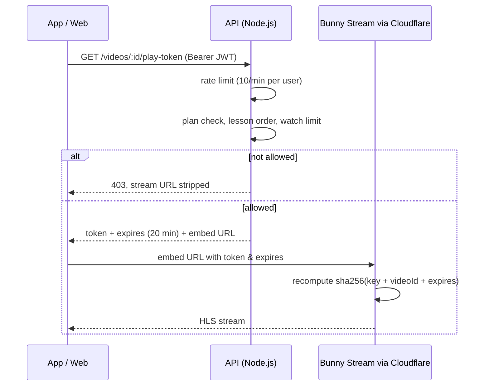

# secure-video-delivery

How paid video lectures are served at Knowledge Nation and First IAS: 4 native apps and 2 web platforms streaming from Bunny Stream (adaptive HLS) behind Cloudflare.

The goal is practical piracy resistance without full DRM. A viewer who hasn't paid never receives a stream URL, and a link that does leak stops working within minutes.

This repo is a small, tested reference version of the approach. The production code lives in a private repository.

## Request flow



## What each layer does

| Layer | Implementation | Why |
|---|---|---|
| Entitlement | `checkAccess()`: plan match, lessons unlock in order, optional watch limit | The decision happens before anything is signed, so a viewer without access has nothing to copy |
| Signed URL | `issuePlayToken()`: `sha256(tokenAuthKey + videoId + expires)`, 20-minute TTL | The CDN validates at the edge. Editing the link or using it after expiry fails without touching the origin |
| Token rate limit | `allowTokenRequest()`: sliding-window log in a Redis sorted set, 10/min per user | Stops scripts from harvesting fresh tokens in a loop |
| Response headers | `playbackHeaders`: `no-store`, `X-Frame-Options: SAMEORIGIN`, `nosniff` | Tokens are never cached by proxies, and the player can't be framed on other sites |
| Edge | Cloudflare in front of the API; referrer allowlist for web, download-tool user agents blocked | Cheap filtering before requests reach Node |

## Lessons from production

- **The first rate limiter kept timestamps in a `Map` in process memory.** That works on one instance but not behind a load balancer, and it grows until cleaned up. The version here uses a Redis sorted set: shared across instances, and it expires on its own.
- **Short TTL beats clever obfuscation.** Twenty minutes is long enough for a lecture to start and buffer, and short enough that a link posted in a group chat is dead by the time most people click it.
- **Why not DRM (Widevine / FairPlay)?** It needs a license server, per-platform integration and a higher CDN tier. For course videos, signed short-lived URLs plus entitlement checks are enough to stop casual sharing, at a fraction of the cost. DRM is the next step if screen-recording becomes the main leak.

## Run the tests

```bash
npm install && npm test
```

## Stack

Node.js · TypeScript · Redis · Bunny Stream (HLS) · Cloudflare · Express / NestJS
